# 🧊 FridgeWatch — Intelligent Inventory & AI Culinary Assistant

  
  <h3>Zero-Waste Kitchen Intelligence & Personalized Meal Recommendations</h3>

  
  
  
  
  

---

> **FridgeWatch** is a cross-platform pantry management and AI culinary assistant application. By pairing computer vision with zero-waste culinary intelligence, FridgeWatch tracks food freshness, monitors expiration dates across custom kitchen locations, and synthesizes step-by-step recipes from ingredients already in your kitchen.

---

## 📱 Visual Feature Showcase

### 1. Smart Inventory & Expiry Tracking
Track items across custom kitchen storage zones (**Fridge**, **Freezer**, **Pantry**) with deterministic shelf-life calculation, category color tagging, and color-coded expiration indicators (Urgent, Soon, Good).

  <table>
    <tr>
      <td align="center" width="50%">
        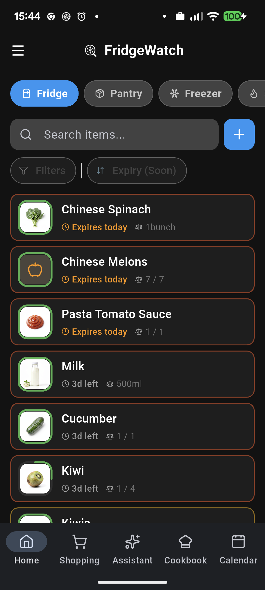 
        <b>Inventory Home Screen</b> 
        <i>Real-time freshness counters, category badges, and quick location switching</i>
      </td>
      <td align="center" width="50%">
        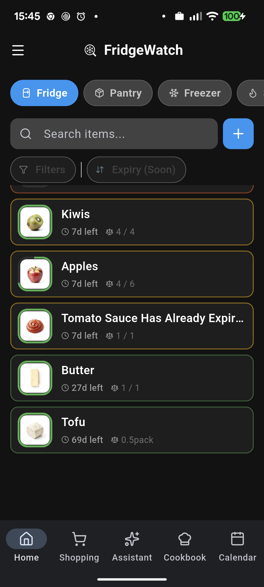 
        <b>Pantry & Dry Storage View</b> 
        <i>Multi-location inventory tracking with item quantities and shelf life</i>
      </td>
    </tr>
  </table>

---

### 2. AI Sous-Chef & Zero-Waste Meal Planning
Powered by **Google Gemini Flash**, the in-app culinary assistant analyzes your current stock, identifies ingredients nearing expiration, suggests recipes to prevent waste, and executes natural-language pantry commands (e.g. *"I ate a kiwi"*, *"Add 2 avocados with 4 days shelf life"*).

  <table>
    <tr>
      <td align="center" width="50%">
        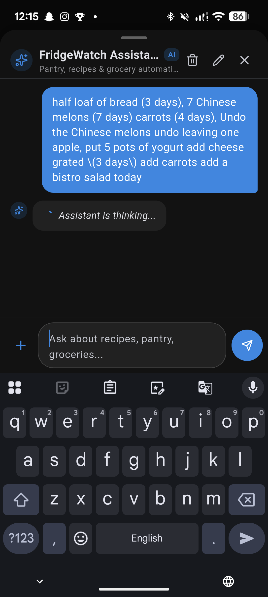 
        <b>AI Culinary Assistant Chat</b> 
        <i>Conversational recipe creation, meal planning, and dynamic culinary suggestions</i>
      </td>
      <td align="center" width="50%">
        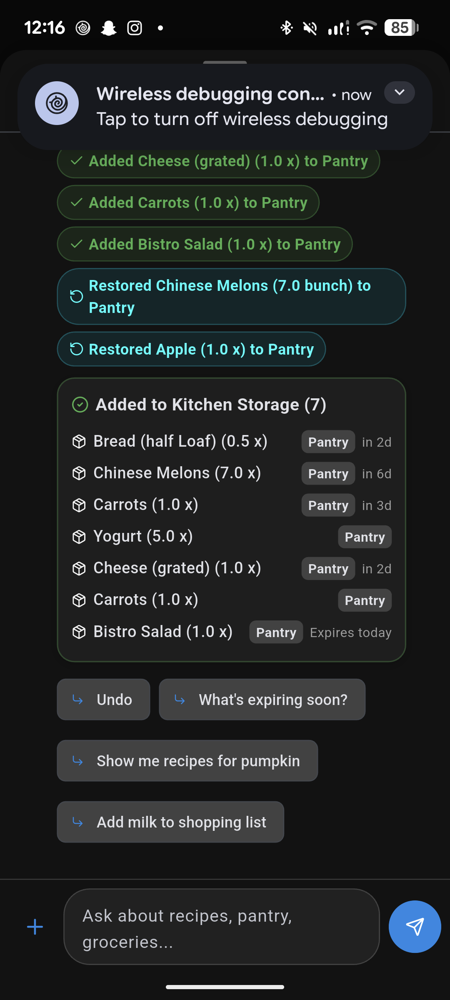 
        <b>Intelligent Kitchen Audit</b> 
        <i>Automated expiry review, multi-location disambiguation, and meal prioritization</i>
      </td>
    </tr>
  </table>

---

### 3. USDA Nutrition Analytics & Consumption History
Integrates an offline laboratory reference database of **480+ USDA FoodData Central** staple foods. Calculates daily and weekly calorie totals, macronutrient splits (Protein, Carbs, Fats, Fiber), and allows users to shift logged dates or recalibrate metrics in real time.

  <table>
    <tr>
      <td align="center" width="50%">
        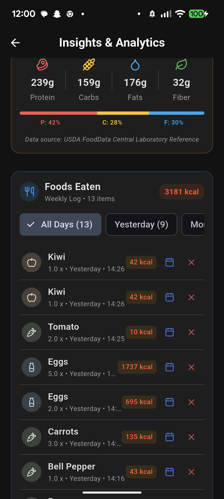 
        <b>USDA Nutritional Breakdown</b> 
        <i>Weekly consumption progress, macronutrient distribution bars, and logged meals</i>
      </td>
      <td align="center" width="50%">
        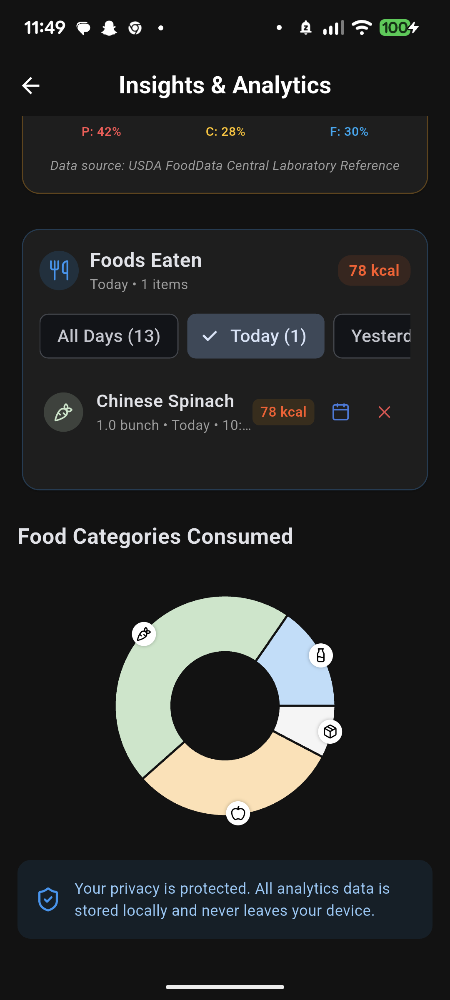 
        <b>Granular Day Filtering</b> 
        <i>Dynamic day chips (Today, Yesterday, Custom) with one-tap date shifting</i>
      </td>
    </tr>
  </table>

---

### 4. Item Details, Restocking & Grocery Management
Tap any food card to view full nutrition data, adjust shelf life, change storage locations, or set reminders. When consuming food, a smart confirmation dialog offers instant restoration back to stock or additions to your shopping list.

  <table>
    <tr>
      <td align="center" width="33%">
        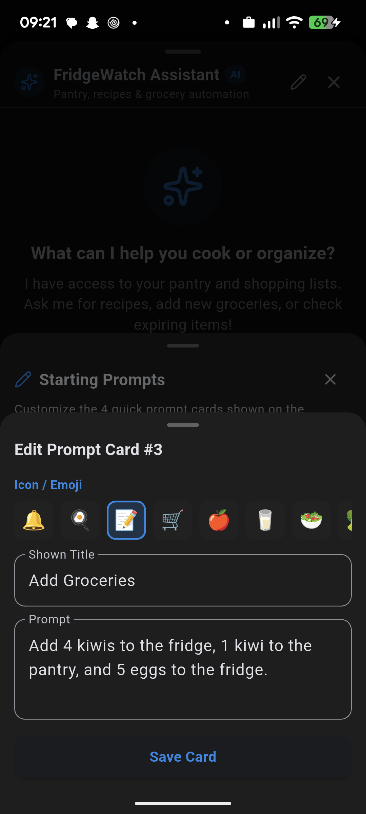 
        <b>Shelf Life & Item Editor</b> 
        <i>Edit quantity, location, expiration date, and reminder intervals</i>
      </td>
      <td align="center" width="33%">
        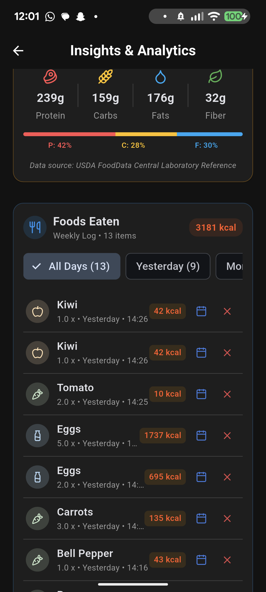 
        <b>Smart Consumption Dialog</b> 
        <i>Cross-off verification with optional inventory restoration</i>
      </td>
      <td align="center" width="33%">
        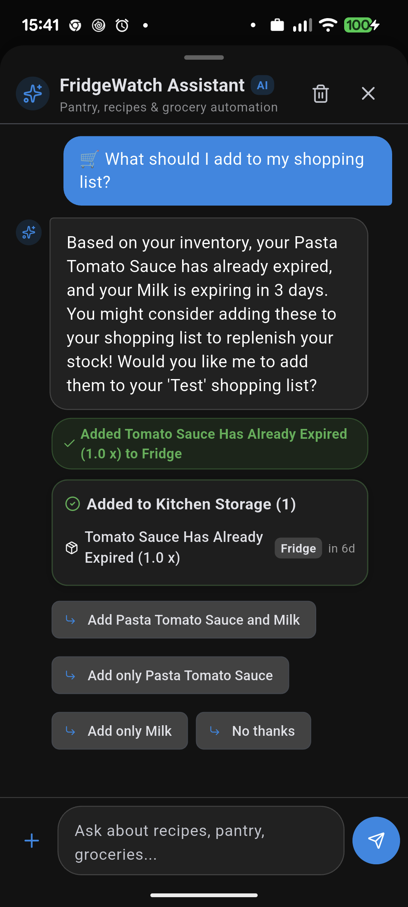 
        <b>Integrated Shopping List</b> 
        <i>Cross off purchased groceries and sync directly into pantry stock</i>
      </td>
    </tr>
  </table>

---

### 5. Zero-Waste Challenges & Household Milestones
Stay motivated to cut household food waste through goal-oriented challenges, waste-reduction streaks, and milestone achievements.

  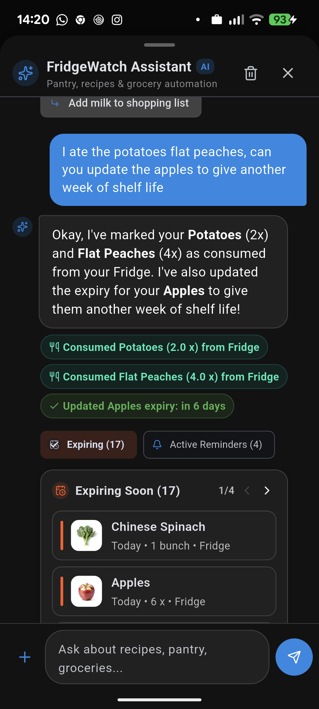 
  <b>Zero-Waste Challenges & Streaks</b> 
  <i>Track waste reduction goals, active streaks, and food-saving achievements</i>

---

### 6. Power-User Workflows & Local Intent Routing
Designed for speed with local short-circuit intent routing (0 LLM tokens, <50ms response for inventory queries), instant undo capabilities, customizable quick prompts, and background push reminders.

  <table>
    <tr>
      <td align="center" width="33%">
        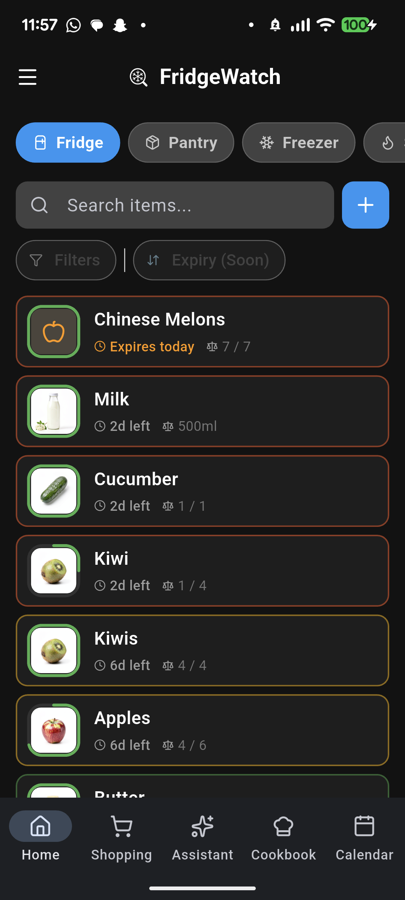 
        <b>Modular Navigation</b> 
        <i>Quick access to scanner, calendar, assistant, and settings</i>
      </td>
      <td align="center" width="33%">
        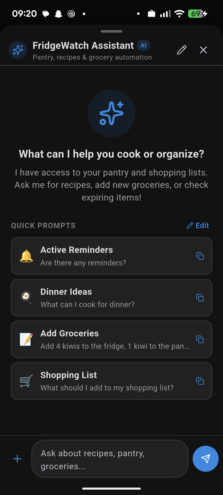 
        <b>Custom AI Prompts</b> 
        <i>Create personalized one-tap prompts for common culinary routines</i>
      </td>
      <td align="center" width="33%">
        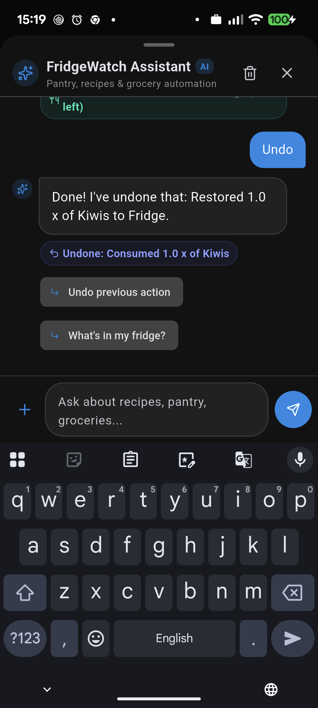 
        <b>Zero-Token Local Undo</b> 
        <i>Instant in-memory reversal stack with non-blocking feedback</i>
      </td>
    </tr>
  </table>

---

## 🛠️ Technical Stack & Architecture

* **Client**: Cross-platform mobile client built with **Flutter / Dart** for high-framerate iOS and Android performance.
* **AI & Vision Pipeline**: Multi-modal vision analysis using **Google Gemini Flash** with strict JSON schema parsing, preset enrichment, and prompt compression (~65% token reduction).
* **Local-First Routing Engine**: Tier 0 pre-LLM regex short-circuiting routing frequent pantry queries locally in 0ms and 0 tokens.
* **Nutrition Database**: Offline registry of **480+ USDA FoodData Central** items with dynamic macronutrient scaling.
* **Backend & Auth**: **Supabase (PostgreSQL)** with Row-Level Security (RLS) for cloud synchronization, multi-device backup, and inventory data storage.
* **Offline Cache**: Local SQLite / Shared Preferences cache ensuring 100% offline functionality.

---

## 🔒 Source Code Notice

> **Notice**: This repository is a **public showcase and architectural summary**. The core source code is maintained in a private repository for personal use.  
> Demos and technical walkthroughs are available upon request for interview purposes.
